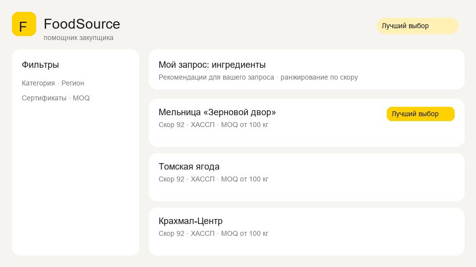

# FoodSource

B2B-помощник закупщика продуктов: фильтры, прозрачный скоринг, сравнение 2–3 поставщиков, локальные заметки и экспорт шортлиста в CSV.



## Быстрый старт

```bash
docker compose up --build
```

| Сервис | URL |
|--------|-----|
| UI (клиент) | http://localhost:8080 |
| API | http://localhost:8000 |
| Swagger | http://localhost:8000/docs |

Клиент в [`client/`](client/) подключается к API через `VITE_API_URL=http://localhost:8000` (задаётся в Docker). Без переменной UI работает на встроенном моке с тем же контрактом.

Локально без Docker:

```bash
# API
cd backend && py -3 -m pip install -r requirements.txt
py -3 -m uvicorn app.main:app --reload --port 8000

# UI (другой терминал)
cd client && npm install
set VITE_API_URL=http://localhost:8000   # Windows
npm run dev
```

## Скоринг (0–100)

Баллы начисляются по активным критериям запроса и нормируются на их сумму:

| Критерий | Вес |
|----------|-----|
| Категория совпадает | +30 |
| Регион совпадает | +20 |
| Есть сертификаты (если запрошены) | +20 |
| MOQ ≤ вашего лимита | +15 |
| Цена ≤ бюджета за единицу | +10 |
| Заполненность контактов (тел./email/сайт) | до +10 |
| Данные моложе 180 дней | +5 |

**Reasons** — человекочитаемые строки из сработавших критериев (например «Совпадает регион», «MOQ ниже вашего запроса»). Без запроса оценивается полнота карточки (сертификаты, MOQ, цена, контакты, свежесть).

Бейдж **«Лучший выбор»** — топ-1 по скору при активном query brief; в общем списке подсвечиваются топ-3.

## API

См. также [`client/README.md`](client/README.md).

- `GET /suppliers` — фильтры + `brief_*` для скоринга
- `GET /suppliers/{id}`
- `POST /compare` — `{ ids: [2..3], brief? }`
- `POST /recommend` — query brief → топ-3 с объяснением
- `GET /meta` — справочники для фильтров

CSV шортлиста формируется **на клиенте** (включая заметки из localStorage).

## Ограничения прототипа

- Данные — ручной сид (~20 вымышленных поставщиков), не парсинг сайтов
- Нет авторизации
- Заметки и статусы только в браузере (localStorage)

## Что дальше

- Парсинг и актуализация источников
- Рейтинги и отзывы
- Интеграция с CRM
- Авторизация и общие заметки
- Настройка весов скоринга слайдерами в UI

## Структура

```
food-source/
  backend/          # FastAPI + SQLite
  client/           # TanStack Start + React
  docker-compose.yml
  demo.gif
```
